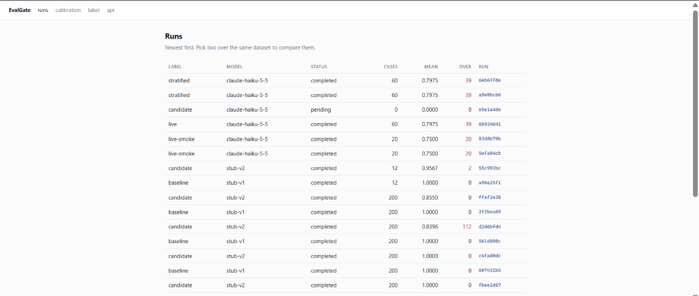
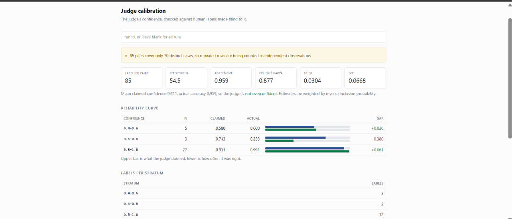
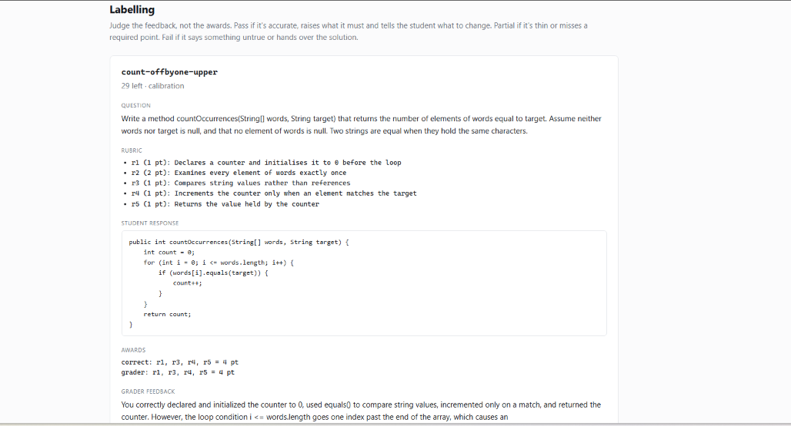

# EvalGate

An evaluation harness for LLM graders. It scores a model's rubric decisions against
human ground truth, measures whether its own judge can be trusted, and refuses to
call a change an improvement unless the statistics support it.

**Live API and docs:** https://evalgate-pi.vercel.app/docs

The subject under evaluation is an AP Computer Science A grader: given a free-response
question, an official-style rubric and a student's Java, it awards rubric items and
writes feedback addressed to the student. Everything here generalises to any task
where a model makes a judgement that a human would otherwise make.

## What it found

Claude Haiku 5.5 grading 60 authored cases across four questions:

| | |
|---|---|
| mean score against gold awards | 0.7975 |
| cases matching the rubric exactly | 76.7% |
| rubric points awarded that weren't earned | 39 |
| rubric points missed that were earned | 7 |
| cost of the full run | $0.79 |

Over-crediting runs at more than five times the under-crediting, and almost all of it
sits in one place. Broken out by error mode, the grader is strong everywhere except a
single family of mistake:

```
  correct            n=13   mean=1.000  over=0
  off_by_one         n=7    mean=1.000  over=0
  reference_equality n=2    mean=1.000  over=0
  initialisation     n=5    mean=1.000  over=0
  return_value       n=5    mean=0.920  over=0
  incomplete         n=5    mean=0.880  over=0
  traversal_shift    n=2    mean=0.700  over=0
  logic              n=3    mean=0.667  over=0
  syntax             n=8    mean=0.000  over=38
```

Eight cases of code that does not compile, scored 0.000, carrying 38 of the 39
unearned points. The grader reasons about what the student meant and treats syntax as
a cosmetic aside. On two of those cases it awarded full marks and then listed the
missing semicolons as a closing note. On another it wrote *"under the rubric as given,
the logic earns full credit"* about code that cannot be compiled.

A student reading that feedback is told their broken program is correct. That is a
specific, reproducible, mechanistic failure, and it was found by measurement rather
than by noticing something odd.



## Why over-crediting is the metric

Most eval harnesses report accuracy. In grading, the two directions of error are not
interchangeable. Missing a point a student earned gets caught the moment they
complain. Awarding a point they didn't earn goes onto a transcript.

So every run reports the two separately and never nets them off, and the regression
gate checks over-crediting *before* it looks at the aggregate score. A candidate that
scores better overall while handing out more unearned points is a regression, and the
gate says so.

## Measuring the measuring instrument

An LLM judge reviews each piece of grader feedback and returns a verdict with a
confidence number. That number is a claim, so the harness checks it: 50 cases were
labelled by hand, blind to the judge's verdict, and the judge was scored against them.

```
labelled calibration pairs: 50
distinct cases:             50
human agreement:            0.940
cohen's kappa:              0.796
brier score:                0.0433
expected calibration error: 0.0638
mean judge confidence:      0.911

reliability curve
  bin               n   claimed   actual      gap
  0.4-0.6           2     0.575    0.500   -0.075
  0.6-0.8           1     0.720    0.000   -0.720
  0.8-1.0          47     0.929    0.979   +0.049

agreement by judge verdict
  pass      0.976
  fail      0.833
  partial   0.500
```

Kappa of 0.796 is the number that matters, more than the raw 0.940. A judge that
always says "pass" on a mostly-passing set scores high agreement by accident, and
kappa strips that out. 0.796 is substantial agreement by any standard reading.

The judge is also mildly *under*confident rather than overconfident, which is the rarer
and more useful direction: in the 0.8-1.0 band it claims 0.929 and delivers 0.979. And
it is far more reliable when approving than when rejecting, which tells you exactly
where a human's attention is worth spending.



Two design properties make these numbers mean something.

**Labelling is blind structurally, not by convention.** The object handed to the
labelling interface has no verdict and no confidence field on it. Not hidden by the
renderer, absent from the type, with tests asserting it stays that way in both the
terminal and the web UI. If you can see the judge's answer while labelling, the
agreement number you compute afterwards is circular.

**The calibration sample is drawn before triage, at random.** The obvious design routes
low-confidence results to review. Label only those and you've measured the judge
exactly where it said it was unsure, which says nothing about the high-confidence cases
you were about to auto-approve. So there are two populations: a random sample for
measurement and a triage queue for action, and the metrics only ever use the first.

### Stratified sampling with inverse-probability weights

A judge that reports 0.9 on most cases produces a random sample that is nearly all
high confidence, so the interesting end of the curve stays empty. EvalGate fixes that
properly rather than by labelling more of the same.

Results are split into strata by confidence, a fixed number is drawn from each stratum
regardless of how rare it is, and every label carries the inverse of its inclusion
probability as a weight. Agreement, kappa, Brier, ECE, the reliability curve and the
threshold search are all weighted, so deliberately oversampling a rare stratum buys
coverage without distorting the estimate. Kish's effective sample size is reported
alongside the raw count, so the precision cost of the weighting is visible rather than
hidden. A simple random sample is the special case where every weight is 1, and the
numbers collapse to the ordinary ones exactly.

### The report polices itself

A calibration report that comes back perfect is usually describing its inputs rather
than the judge, so the report checks its own inputs and says so. It flags a sample too
small to support the statistics, repeated cases being counted as independent
observations, a confidence distribution confined to one bin, and suspiciously perfect
agreement. The threshold recommendation carries its own separate warnings, because a
cut can be unsupported even when the agreement numbers are sound:

```
recommended review threshold: 0.550
  above it: 100.0% of cases at 94.0% accuracy
  below it: 0 pairs at 0.0% accuracy
  ! this cut sends nothing to review, so it is not a working threshold
  ! only 0 labelled pairs fall below the cut, so its low side is unmeasured
```

A tool that tells you when not to believe it is more useful than one that always
sounds certain.

## Deciding whether a change is real

Two runs over the same cases are compared with a paired bootstrap on the per-case
difference, and the verdict has four states rather than two:

- **regressed** if over-crediting rose significantly, or the score interval sits below
  zero by more than the minimum effect
- **improved** if the interval sits above zero by more than the minimum effect
- **no change** if the whole interval fits inside the minimum-effect band, which rules
  out a difference worth acting on
- **inconclusive** if the interval straddles zero and is too wide to rule one out

Only the middle two pass. Inconclusive failing the gate is the point: it is not the
same as "nothing changed", and a gate that treats them alike waves regressions through
whenever the dataset is small. When a comparison is inconclusive the tool estimates how
many more paired cases would settle it.

The same 30% over-crediting injected into 200 cases is a confident regression. Into 12
cases it is an honest "not enough data, you'd need about 217".

## Tamper-evident results

A finished run is sealed into a hash chain, one link per result, each covering
everything before it. Three distinct forgeries are detectable: editing a result row,
editing a row together with its own fingerprint, and rewriting the chain itself.

```
$ psql -c "update results set overall = 1.0 where overall = 0.0"
UPDATE 9

$ evalgate verify 6b934641-3ae6-4923-b4b8-de0c8383c138
links: 60
root:  ac573b03cd7fba424330e158c1cb3043f8fd767c0a640b4a955dc9b841e190b3
integrity: FAILED
  seq 7:  row: case count-length-as-method no longer matches its own fingerprint
  seq 8:  row: case count-missing-paren no longer matches its own fingerprint
  seq 17: row: case remove-clears-everything no longer matches its own fingerprint
  seq 25: row: case remove-length-not-size no longer matches its own fingerprint
  ...
```

That edit rewrites exactly the eight non-compiling cases to look like full marks, which
is the specific lie someone would tell about this run. All nine altered rows are named
by case id. Each link also carries the score it was sealed with, so the chain doubles
as a recovery record and the run can be restored from it.

## The work queue

Postgres is the queue. Workers claim batches with `SELECT ... FOR UPDATE SKIP LOCKED`,
heartbeat while they work, and anything a dead worker was holding is returned to the
queue by whoever notices. No Redis, no Celery, no Kafka.

Delivery is at-least-once and the unique constraint on `(run_id, case_id)` is what
makes that safe, so a retry after a crash bounces off the database rather than
double-counting. Kill a worker mid-run across 500 cases and every case is still graded
exactly once, which is a test in the suite and not an aspiration.

Model responses are cached by a hash of everything that determines the answer, and
every call is written to a separate append-only ledger. A rerun of an identical
evaluation reports the same work at zero cost, which is also where reproducibility
comes from: the API no longer accepts sampling parameters, so replaying a cached
response is the only way to get the same answer twice.

## Labelling

Blind, keyboard-driven, in the terminal or the browser. The card shows the question,
the rubric, the student's code, the correct awards, what the grader awarded and the
feedback under judgement, and nothing about what the judge thought.



## Running it

Python 3.12 and Docker.

```bash
docker compose up -d                 # Postgres on 5433
uv sync
uv run alembic upgrade head

uv run evalgate dataset load datasets/apcs --version 1
RUN=$(uv run evalgate run start --dataset apcs-frq@1 --model claude-haiku-5-5)
uv run evalgate grade "$RUN"         # needs ANTHROPIC_API_KEY
uv run evalgate run status "$RUN"
```

Measure the judge:

```bash
uv run evalgate review enqueue "$RUN" --stratified --per-stratum 12
uv run evalgate review label --run-id "$RUN" --labeller you
uv run evalgate calibrate --run-id "$RUN"
```

Gate a change and seal the record:

```bash
uv run evalgate run compare "$CANDIDATE" "$BASELINE"   # exit 1 on a regression
uv run evalgate seal "$RUN"
uv run evalgate verify "$RUN"
uv run evalgate report "$RUN" --baseline "$BASELINE" --out report.json
```

`evalgate worker` runs the whole pipeline against a deterministic stub grader, so the
queue, the gate and the audit chain can be exercised without spending anything.
`evalgate serve` brings up the dashboard at `/ui` and OpenAPI docs at `/docs`.

Every pull request runs the full suite against a real Postgres, then grades a baseline
and a deliberately worse candidate and asserts that the gate rejects it. A workflow
that only tests the happy path tells you nothing about whether a gate works.

## How it's built

Python throughout. FastAPI, Postgres 16, SQLAlchemy 2 in async mode with Alembic
migrations, Pydantic at every boundary, Jinja and HTMX for the dashboard, Typer for the
CLI, pytest, ruff and mypy in strict mode. 301 tests.

```
src/evalgate/
  core/        pure logic: scorers, statistics, calibration, the hash chain
  db/          models, queue, repositories, review
  judge/       API client, response cache, cost ledger, the feedback judge
  runner/      grading loop and workers
  api/         FastAPI routers
  web/         server-rendered dashboard
  cli/         the evalgate command
datasets/apcs/ the authored case corpus
```

`core/` imports no database driver, no web framework and no HTTP client, and a test
walks its imports to keep it that way. Most of the suite runs in milliseconds against
no database at all, which is why 301 tests finish in under 40 seconds.

The case corpus is 60 responses across four questions, each with hand-assigned rubric
awards and hand-written feedback requirements, covering fifteen error modes from
off-by-one to reference equality to collection mutation during iteration. The loader
rejects duplicate responses outright, because a corpus that repeats itself inflates
every sample size downstream.

## Deployment

One container running the API, Postgres on Neon, serving read-only. The public
deployment rejects every non-GET request at the middleware rather than relying on
nobody finding the write endpoints. Workers are not deployed: grading costs money and
needs an API key, so it stays a local or CI operation.
